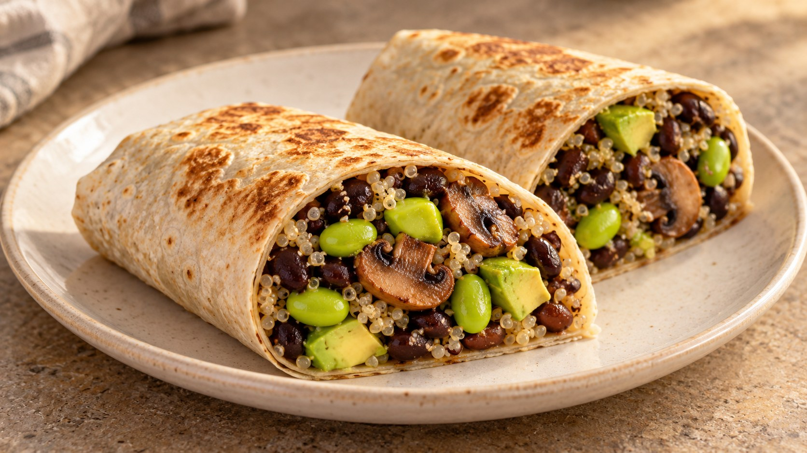
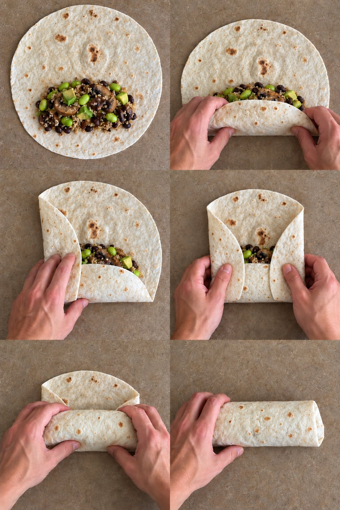

# Burrito de frijoles negros

Con quinoa, edamame, champiñones y aguacate · 2 burritos grandes · 2 personas · 25-30 min

Ilustración generada con IA.

[Descargar PDF A4](burrito-frijoles-negros.pdf)

## Ingredientes

- 1 lata de [frijoles negros guisados](productos/frijoles-negros-guisados-gusto-pan.html) (410 g, con salsa)
- 50 g de quinoa en seco
- 80-100 g de edamame desgranado
- 100 g de champiñones
- 1 aguacate mediano
- 2 tortillas grandes de trigo (unos 30 cm)
- 1 cdta. de aceite de oliva virgen extra
- 1-2 cdtas. de zumo de lima
- Comino molido (opcional, después de probar)
- 2 cdas. de pico de gallo (opcional, escurrido)

## Preparación

**Cuece la quinoa y prepara el edamame · Unos 15 min.** Enjuaga la quinoa en un colador fino y cuécela según el envase. Déjala reposar tapada unos minutos y suelta los granos con un tenedor. Mientras, cocina el edamame según el envase y escúrrelo bien; la cantidad indicada es sin vainas.

**Saltea los champiñones · 5-7 min.** Limpia los champiñones con un paño húmedo o enjuágalos brevemente y sécalos bien. Córtalos y saltéalos con el aceite a fuego medio-alto hasta que pierdan el agua y empiecen a dorarse. Si ya están cocinados, omite el aceite y añádelos en el siguiente paso.

**Añade y espesa los frijoles · 5-8 min aproximadamente.** Vierte la lata completa en la sartén, sin escurrir ni enjuagar. Cocina destapado a fuego medio-bajo, removiendo, hasta espesar la salsa. No hace falta otro sofrito. Si usas champiñones ya cocinados, añádelos ahora y caliéntalos bien.

**Mezcla el relleno · 1-2 min.** Añade el edamame y la quinoa cocida. Mezcla y calienta brevemente. Apaga el fuego, añade la lima y prueba. Pon una pizca de comino solo si te apetece reforzar ese sabor. No añadas sal de entrada.

**Monta y dobla los burritos · 3-4 min.** Calienta ligeramente las tortillas para que sean flexibles. Reparte el relleno formando una franja un poco por debajo del centro y dejando margen alrededor. Añade el aguacate en dados y el pico de gallo escurrido, si lo usas. No sobrecargues las tortillas.

1. **Coloca el relleno.** Forma una franja un poco por debajo del centro de la tortilla templada. Deja margen alrededor.

2. **Recoge el borde inferior.** Lleva el borde más cercano por encima del relleno y recógelo suavemente hacia ti para compactarlo.

3. **Dobla el lado izquierdo.** Lleva el lateral izquierdo hacia dentro, sobre el extremo del relleno.

4. **Dobla el lado derecho.** Haz lo mismo con el lateral derecho, manteniendo recogido el borde inferior.

5. **Enrolla hacia delante.** Rueda el paquete desde el borde inferior hacia el superior, manteniendo los laterales metidos.

6. **Deja el cierre debajo.** Termina de enrollar y apoya el burrito sobre el cierre para que no se abra.

Imágenes ilustrativas generadas con IA.

**Dora y sirve · 1-2 min por lado.** Coloca los burritos en una sartén antiadherente sin aceite, primero con el cierre hacia abajo. Dora a fuego medio hasta que mantengan la forma y estén ligeramente tostados.

## Claves

Relleno espeso y champiñones sin agua; aguacate al montar; no sobrecargar las tortillas. Sin sal añadida de entrada.
