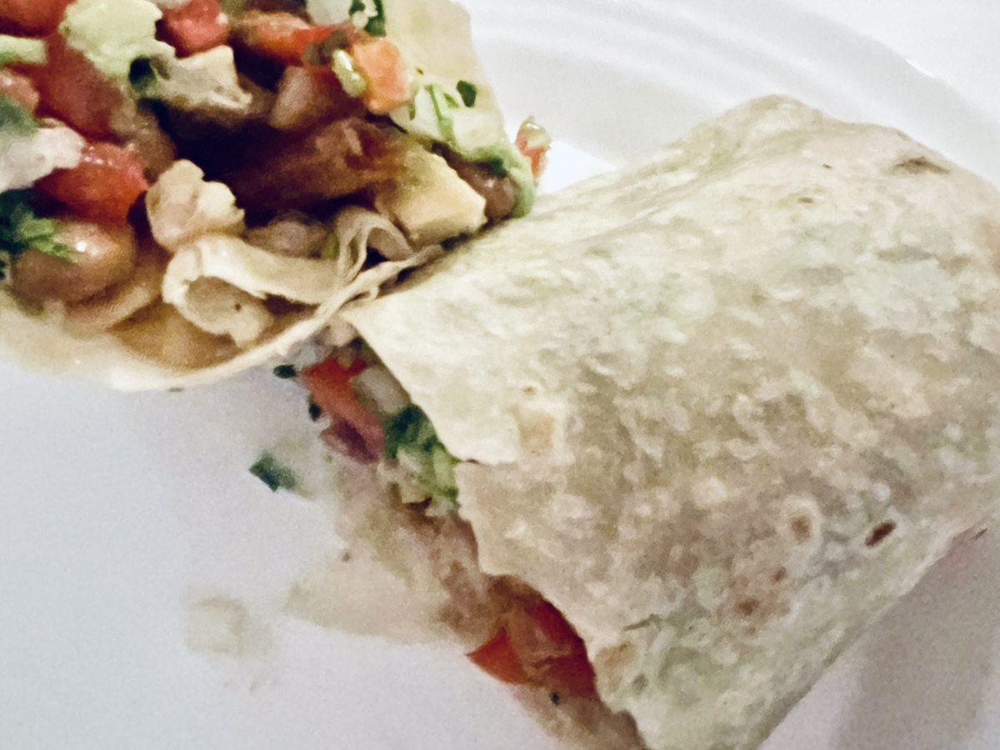

# Burritos de frijoles negros, quinoa, edamame y champiñones

Con aguacate · 2 burritos grandes · 2 personas · 25-30 min

Foto: <a href="https://commons.wikimedia.org/wiki/File:Vegetarian_burrito_(Los_Angeles)_July_2022.jpg">Benoît Prieur</a> · <a href="https://creativecommons.org/publicdomain/zero/1.0/">CC0 1.0</a>. Fotografía representativa de un burrito vegetariano; el relleno mostrado puede diferir de esta receta. Reducida para web.

[Descargar PDF A4](burritos-frijoles-quinoa-edamame-champinones.pdf)

## Ingredientes

- 1 lata de [frijoles negros guisados](productos/frijoles-negros-guisados-gusto-pan.html) (410 g, con salsa)
- 50 g de quinoa en seco
- 80-100 g de edamame desgranado
- 100 g de champiñones
- 1 aguacate mediano
- 2 tortillas grandes de trigo (unos 30 cm)
- 1 cdta. de aceite de oliva virgen extra
- 1-2 cdtas. de zumo de lima
- Comino molido (opcional, después de probar)
- 2 cdas. de pico de gallo (opcional, escurrido)

## Preparación

1. **Cuece la quinoa · Unos 15 min.** Enjuágala en un colador fino y cuécela siguiendo la proporción de agua y el tiempo del envase. Deja reposar tapada unos minutos y suelta los granos con un tenedor. Mientras se cocina, prepara el edamame y los champiñones.

2. **Prepara el edamame · Según el envase.** Cocina el edamame según el envase y escúrrelo bien. La cantidad indicada corresponde a los granos, sin vainas.

3. **Saltea los champiñones · 5-7 min.** Limpia los champiñones con un paño húmedo; si tienen tierra adherida, enjuágalos brevemente y sécalos bien, sin remojarlos. Córtalos en láminas o trozos pequeños. Saltéalos con la cucharadita de aceite a fuego medio-alto, hasta que pierdan el agua y empiecen a dorarse. Si ya están cocinados, añádelos cuando los frijoles hayan espesado y omite el aceite del salteado.

4. **Añade y espesa los frijoles · 5-8 min aproximadamente.** Vierte la lata completa en la misma sartén, sin escurrir ni enjuagar. Cocina a fuego medio-bajo, destapado y removiendo, hasta que la salsa quede espesa. Ya llevan cebolla, pimientos y especias: no añadimos otro sofrito. Si usas champiñones ya cocinados, incorpóralos ahora y caliéntalos bien.

5. **Mezcla el relleno · 1-2 min.** Añade el edamame y la quinoa cocida. Mezcla y calienta brevemente. Apaga el fuego, añade la lima y prueba. Pon una pizca de comino solo si te apetece reforzar ese sabor. No añadas sal de entrada.

6. **Monta y dobla los burritos · 3-4 min.** Calienta ligeramente las tortillas para que sean flexibles. Reparte el relleno formando una franja en el centro y dejando margen alrededor. Añade el aguacate en dados y el pico de gallo escurrido, si lo usas. Dobla ambos laterales hacia dentro. Lleva el borde más cercano por encima del relleno y recógelo suavemente hacia ti para compactarlo. Sigue enrollando con los laterales metidos. Si cuesta cerrarlos, reparte entre más tortillas o sirve el relleno sobrante al lado.

7. **Dora y sirve · 1-2 min por lado.** Coloca los burritos en una sartén antiadherente sin aceite, primero con el cierre hacia abajo. Dora a fuego medio hasta que mantengan la forma y estén ligeramente tostados.

## Claves

Relleno espeso y champiñones sin agua; aguacate al montar; no sobrecargar las tortillas. Sin sal añadida de entrada. Guía visual de doblado: https://www.bbcgoodfood.com/howto/guide/how-wrap-burrito

[Guía visual para doblar los burritos · Good Food](https://www.bbcgoodfood.com/howto/guide/how-wrap-burrito)
