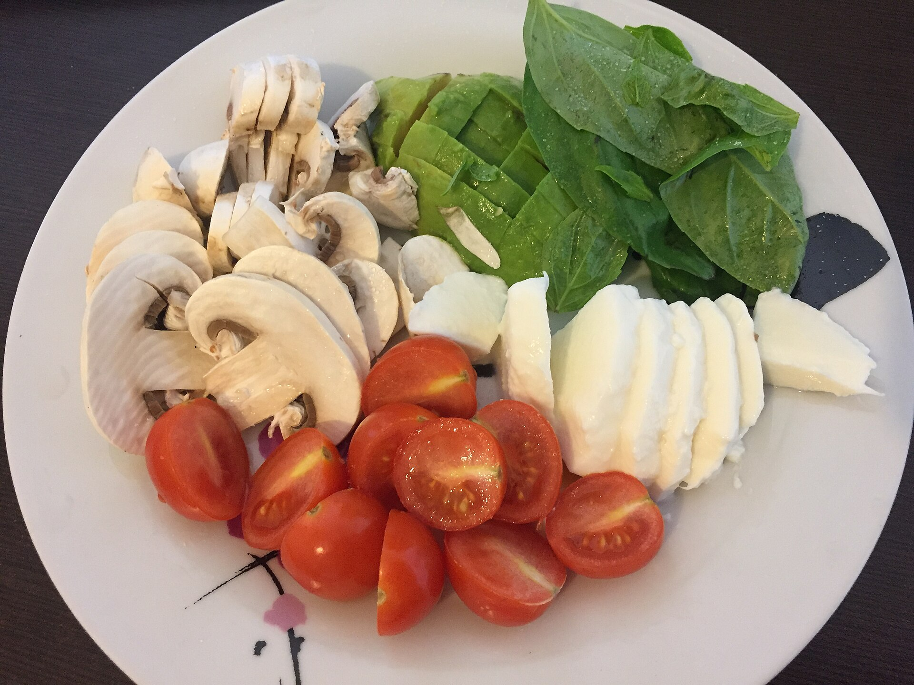

# Canónigos con champiñones, cherrys y feta

Picoteo templado y ligero · 1 ración · 10-12 min

*Foto: [HaJunkiyada](https://commons.wikimedia.org/wiki/File:Liat_Portal_for_Foodie_Disorder_-_Healthy_snack_plate_with_cherry_tomatoes_avocado_mushrooms_and_tzfatit_cheese.jpg) · [CC BY-SA 4.0](https://creativecommons.org/licenses/by-sa/4.0/). Fotografía representativa: muestra los ingredientes sin saltear y también incluye aguacate.*

## Ingredientes

- 100-120 g de champiñones
- 100 g de tomates cherry
- 40-50 g de canónigos
- 30 g de queso feta
- 1 cucharadita de aceite de oliva virgen extra
- sal y pimienta negra al gusto

## Indicaciones

Lamina los champiñones y corta los tomates por la mitad. Saltea los champiñones con el aceite a fuego medio-alto durante 4-5 minutos. Incorpora los tomates y cocina 2-3 minutos más, procurando que se ablanden y se doren ligeramente sin deshacerse. Coloca los canónigos como base, reparte encima el salteado todavía templado y termina con el feta desmenuzado y pimienta negra.

## Consejo

Añade muy poca sal —o ninguna— hasta probarlo, porque el feta ya aporta bastante. Sírvelo inmediatamente para que los canónigos se templen sin perder volumen.
