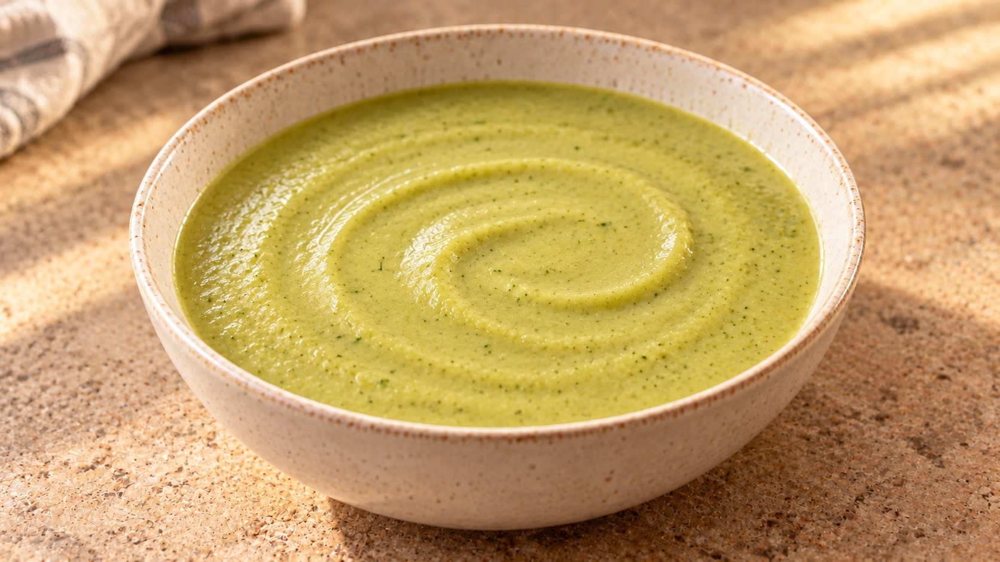
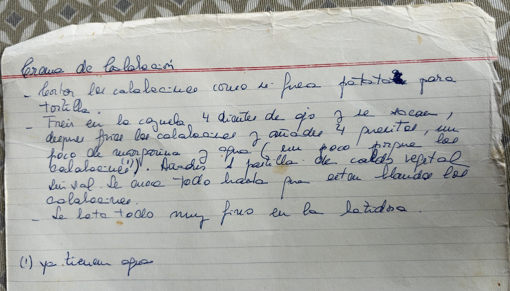

# Crema de calabacín

Con piel y quesitos · 2 raciones · 25–30 min

Ilustración generada con IA.

## Ingredientes

- 600 g de calabacín
- 2 dientes de ajo
- 2 quesitos
- 1 cucharada de aceite de oliva (15 ml)
- 100 ml de agua, aproximadamente
- ½ pastilla de caldo vegetal
- Pimienta (opcional)

## Preparación

1. **Prepara el calabacín · 5 min.** Lava bien los calabacines y conserva la piel. Retira los extremos y córtalos en láminas finas, como las patatas para tortilla. Pela los ajos y aplástalos ligeramente.

2. **Dora los ajos · 2–3 min.** Calienta el aceite en una cazuela a fuego medio-bajo. Añade los ajos y deja que se doren suavemente, sin oscurecerse. Retíralos: su sabor queda en el aceite.

3. **Rehoga el calabacín · 7–8 min.** Incorpora el calabacín y cocina a fuego medio, removiendo de vez en cuando, hasta que se ablande y empiece a soltar agua. No hace falta dorarlo.

4. **Cuece hasta que esté tierno · 10–12 min.** Añade los quesitos, la media pastilla de caldo desmenuzada y 100 ml de agua. Mezcla, tapa y cocina a fuego suave hasta que el calabacín esté completamente blando. Remueve alguna vez para evitar que el queso se agarre al fondo.

5. **Tritura y ajusta · 2 min.** Aparta del fuego y tritura hasta obtener una crema muy fina. Si queda demasiado espesa, añade agua caliente poco a poco. Prueba antes de añadir sal: el caldo y los quesitos ya aportan. Termina con pimienta si te gusta.

## Claves

El calabacín aporta mucha agua: empieza con poca y ajusta después de triturar. Para una textura fina, comprueba que la piel esté tierna antes de apagar el fuego.

## Fuente

Receta de Marisa, a partir de su manuscrito y de cómo se prepara ahora en casa.

## La receta original de Marisa

### Transcripción del manuscrito

**Crema de calabacín**

- Corto los calabacines como si fueran patatas para tortilla.

- Freír en la cazuela 4 dientes de ajo y se sacan, después freír los calabacines y añadir 4 quesitos, un poco de margarina y agua (un poco porque los calabacines (1)). Añadir 1 pastilla de caldo vegetal. Sin sal. Se cuece todo hasta que estén blandos los calabacines.

- Lo bato todo muy fino en la batidora.

(1) Ya tienen agua.

Se han regularizado la puntuación y los saltos de línea. El manuscrito no indica la cantidad de calabacín, agua o margarina ni el número de raciones.

En casa se conserva la piel, se usa un quesito por persona y la margarina se ha sustituido por aceite de oliva. La ficha adapta las cantidades para dos raciones.
