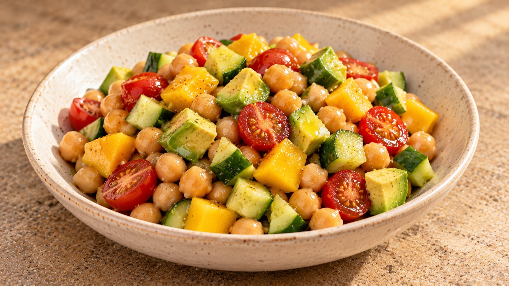

# Ensalada de garbanzos, mango y aguacate

Fresca y crujiente · como plato principal

Ilustración generada con IA.

## Ingredientes

- 400 g de garbanzos cocidos (peso escurrido)
- 150 g de tomates cherry
- 150 g de pepino (aproximadamente medio pepino mediano)
- 150 g de mango (pelado y sin hueso)
- 1 aguacate mediano
- 1 cucharada de aceite de oliva virgen extra
- 1 cucharada de zumo de limón, con algo más para ajustar
- Sal al gusto

## Indicaciones

Enjuaga los garbanzos bajo el grifo y déjalos escurrir bien. Lava los tomates y el pepino; corta los cherrys por la mitad y el pepino en dados de alrededor de 1 cm. Puedes dejarle la piel si te gusta; si tiene semillas grandes y acuosas, retira esa parte. Pela el mango, maduro pero firme, y córtalo en dados. Mezcla el aceite, el limón y una pizca de sal. Junta los garbanzos, los tomates, el pepino y el mango, añade el aliño y remueve. Corta el aguacate justo al final, incorpóralo y mezcla con suavidad. Prueba y ajusta el limón y la sal.

## Consejo

El mango debe aportar pequeños bocados dulces sin dominar la ensalada; el limón contrarresta el dulzor y aligera la sensación del aguacate. Si la preparas con antelación, guarda la mezcla en la nevera y añade el aguacate y el aliño cerca de servir.

## Fuente

🌿 Adaptada de una receta de Eva, la nutricionista
