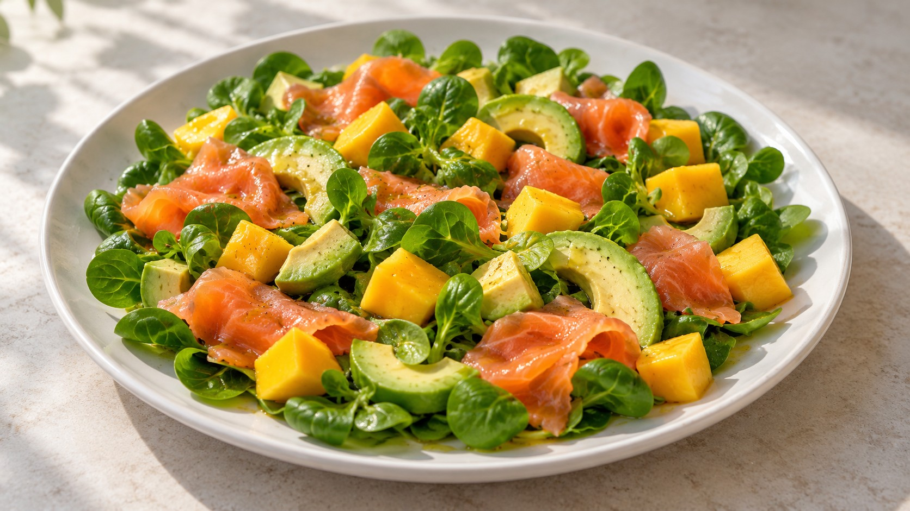

# Ensalada de salmón ahumado, mango y aguacate

Hojas tiernas · contraste dulce y ahumado

Imagen ilustrativa generada con IA; no es una fotografía del plato preparado.

## Ingredientes

- 100 g de canónigos, o mezcla de lechugas y espinacas tiernas
- 150 g de salmón ahumado
- 150 g de mango (pelado y sin hueso)
- 1 aguacate mediano
- 1 cucharada de aceite de oliva virgen extra
- 1 cucharada de zumo de limón, ajustable al gusto
- Pimienta negra
- Sal, solo si hace falta después de probar

## Indicaciones

Lava las hojas si no vienen listas para consumir y sécalas bien. Corta el mango, maduro pero firme, en dados; el salmón en tiras o trozos y el aguacate en dados o láminas. Mezcla el aceite con el limón y un poco de pimienta. Aliña ligeramente las hojas, reparte encima el mango, el aguacate y el salmón, y termina con el aliño restante. Sirve enseguida, sin remover demasiado.

## Consejo

Empieza sin sal y prueba un bocado con salmón antes de añadirla. Si la preparas con antelación, deja el aguacate y el aliño para el momento de servir.
