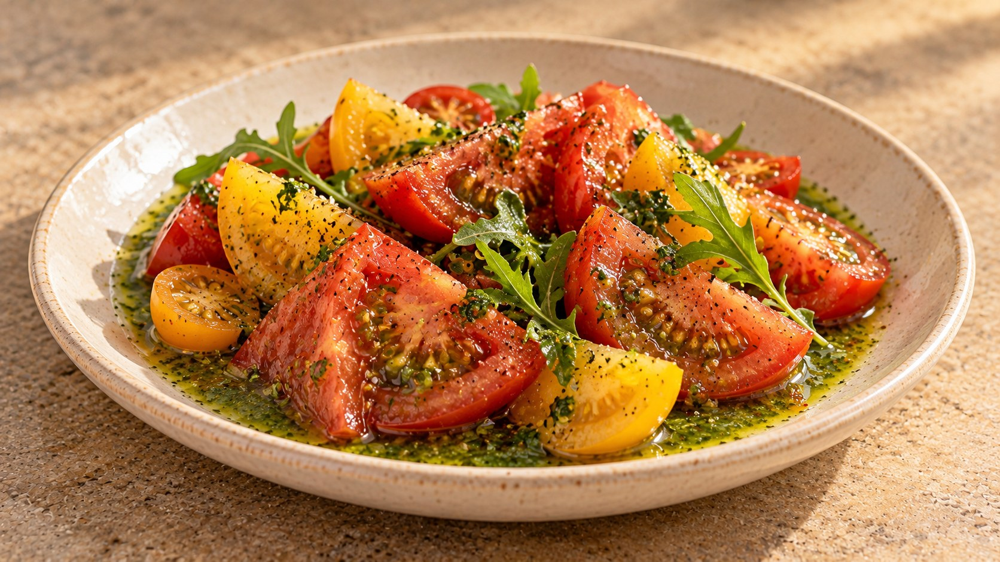

# Ensalada de tomates sobre un lago de albahaca

Tomates variados con aliño de albahaca · como entrante o acompañamiento · 2 raciones · 10 min

Ilustración generada con IA.

## Ingredientes

- 500 g de tomates sabrosos, de variedades diferentes si apetece
- 15 g de hojas de albahaca fresca, sin los tallos gruesos
- 30 ml de aceite de oliva virgen extra (2 cucharadas)
- 10 ml de zumo de limón (2 cucharaditas), ajustable al gusto
- 20 g de rúcula o brotes tiernos
- Sal al gusto
- 1–2 cucharaditas de agua fría, solo si hace falta para triturar

## Indicaciones

Lava los tomates y sécalos. Corta los grandes en gajos o trozos y los cherry por la mitad. Si desprenden mucho líquido, déjalo en la tabla para que no diluya el aliño.

Lava y seca la albahaca. Tritúrala con el aceite, el limón y una pizca de sal en un recipiente estrecho, mediante pulsaciones breves. Si las cuchillas no alcanzan bien la mezcla, añade un poquito de agua fría. Prueba antes de incorporar más limón: buscamos que destaque la albahaca.

Extiende el aliño en una fuente pequeña o reparte entre dos platos. Coloca encima los tomates y termina con la rúcula. Sala ligeramente los tomates justo antes de servir y mezcla con el aliño al comer.

## Claves

- Mejor con tomates que no estén recién sacados de la nevera.
- Se utilizan 30 ml de aceite frente a los 50 ml de la receta de origen. Una fuente pequeña permite mantener el efecto de «lago».
- Si adelantas trabajo, guarda los componentes separados y monta al servir.
- No añadir más hierbas de entrada: dejar protagonismo a la albahaca.

## Fuente

Adaptación de [la receta de Pakus en Directo al Paladar](https://www.directoalpaladar.com/recetas-de-ensaladas/ensalada-de-tomates-sobre-un-lago-de-albahaca-receta-para-el-diadelaensalada), con cantidades y detalles ajustados para este recetario.
