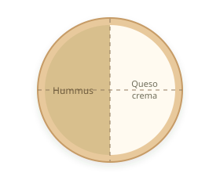
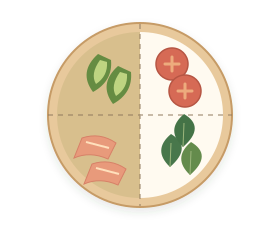
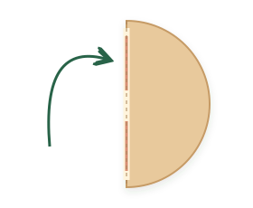
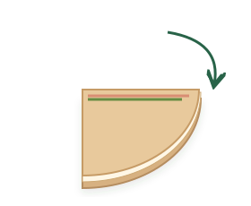

# Fajitas de salmón

Con aguacate, tomate y espinacas · 2 raciones · 10-15 min

## Ingredientes

- 2 tortillas/piadinas grandes (integrales o de espelta)
- 100 g salmón ahumado
- ½ aguacate mediano
- 150 g tomate
- 40 g espinacas frescas
- 20 g hummus y 20 g queso crema o requesón

## Indicaciones

**Prepara el relleno.** Corta el aguacate y el tomate en rodajas finas y deja escurrir bien el tomate. Lava y seca bien las espinacas; si las hojas son muy grandes, córtalas un poco. Escurrir el tomate y secar las hojas evita que la tortilla se humedezca.

**Templa las tortillas.** Caliéntalas al menos 30 s por cada lado en una sartén para que se doblen sin romperse.

**Marca y unta.** Marca 4 partes con un cuchillo (sin cortar). Unta dos con hummus y dos con queso.

**Reparte el relleno.** Un ingrediente en cada cuarto: aguacate, tomate, salmón y espinacas.

**Dobla por la mitad.** Lleva una mitad sobre la otra, con cuidado de que no se salgan los ingredientes.

**Dobla de nuevo.** Y ya tienes el paquete en cuartos.

**Toque de sartén opcional.** Si te apetece un toque crujiente, pasa las fajitas por una sartén antiadherente sin aceite, alrededor de 1 minuto por cada cara a fuego medio.

## Consejo

Si preparas estas fajitas con frecuencia, revisa los ingredientes de las tortillas: muchas llevan estabilizantes, emulgentes y conservadores. Si prefieres una opción sin esos aditivos, puedes usar las [piadinas de espelta](productos/piadina-espelta-biocop.html) de Productos preferidos. Caliéntalas antes de doblarlas siguiendo su envase: en estas piadinas, 1 minuto por cada lado.

## Fuente

🌿 Adaptada de una receta de Eva, la nutricionista
