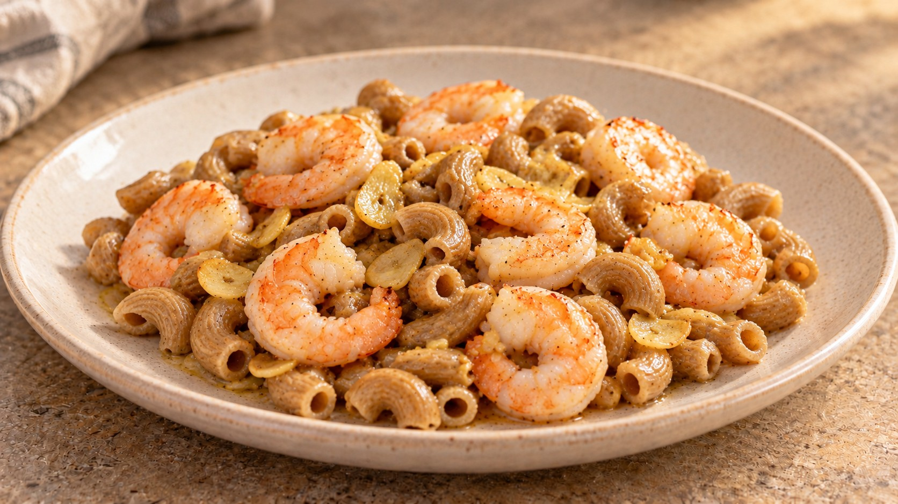
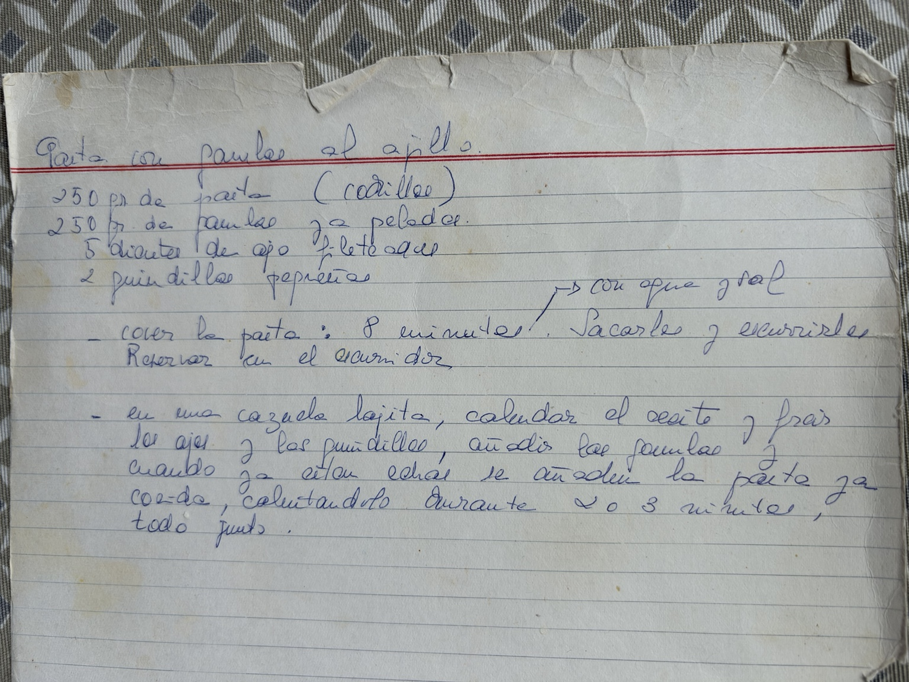

# Gambas al ajillo con pasta

Pasta preferiblemente integral · 2 raciones · 20–25 min

Ilustración generada con IA.

## Ingredientes

- 100 g de pasta seca, preferiblemente integral
- 250 g de gambas crudas peladas congeladas (peso descongelado y escurrido)
- 2 dientes de ajo
- 1 cucharada de aceite de oliva (15 ml)
- 1 guindilla pequeña (opcional)
- Sal
- 2–4 cucharadas de agua de cocción, aproximadamente

## Preparación

1. **Prepara los ingredientes · 5 min.** Descongela las gambas en la nevera siguiendo el envase, escúrrelas y sécalas bien. Pela los ajos y córtalos en láminas finas. Si usas guindilla, déjala entera para un picante suave o ábrela y retira las semillas para moderarlo.

2. **Cuece la pasta · según el envase.** Cuece la pasta en agua hirviendo con sal hasta que esté al dente, siguiendo el tiempo del envase. Mientras cuece, prepara el ajillo y las gambas. Antes de escurrir, reserva una taza del agua de cocción. No enjuagues la pasta ni la dejes esperando en el escurridor.

3. **Prepara el ajillo · 2–3 min, mientras cuece la pasta.** Pon el aceite, el ajo y la guindilla, si la usas, en una cazuela baja o sartén amplia. Calienta a fuego medio-bajo hasta que el ajo empiece a tomar un color dorado suave, sin oscurecerse. Calcula este paso para que las gambas y la pasta estén listas casi a la vez.

4. **Saltea las gambas · 2–4 min.** Sube a fuego medio-alto, añade las gambas en una sola capa y pon una pizca de sal. Dales la vuelta y cocina hasta que estén casi hechas, según su tamaño: terminarán de cocinarse al mezclar con la pasta. Si la pasta aún no está lista, retira las gambas a un plato y aparta la sartén del fuego.

5. **Liga y sirve · 30–60 s.** Añade a la sartén la pasta recién escurrida y dos cucharadas de su agua de cocción. Devuelve las gambas si las habías retirado y mezcla a fuego medio durante 30–60 segundos, hasta que estén opacas también en el centro. Añade algo más de agua si lo necesita: debe quedar jugosa, sin caldo en el fondo. Retira la guindilla, prueba de sal y sirve enseguida.

## Claves

Cuenta 50 g de pasta seca por persona como referencia y elige preferiblemente integral; también sirve pasta normal con la misma cantidad. El tiempo de cocción lo marca el envase, no los 8 minutos del manuscrito. El agua de la pasta ayuda a ligar el aceite y los jugos de las gambas. Evita alargar el calentamiento final para que las gambas no se resequen.

## Fuente

Adaptada de la receta manuscrita de Marisa.

## La receta original de Marisa

### Transcripción del manuscrito

**Pasta con gambas al ajillo**

- 250 gr. de pasta (codillos)
- 250 gr. de gambas ya peladas
- 5 dientes de ajo fileteados
- 2 guindillas pequeñas

- Cocer la pasta: 8 minutos, con agua y sal. Sacarla y escurrirla. Reservar en el escurridor.

- En una cazuela bajita, calentar el aceite y freír los ajos y las guindillas, añadir las gambas y cuando ya están hechas se añade la pasta ya cocida, calentándolo durante 2 o 3 minutos, todo junto.

Se han regularizado la puntuación y los saltos de línea. La anotación «con agua y sal» se integra en el primer paso. El manuscrito no cuantifica el aceite ni indica el número de raciones.

Para dos personas se acuerdan 100 g de pasta seca, preferiblemente integral, y 250 g de gambas peladas. Se ajustan ajo, guindilla, aceite y calentamiento final; el manuscrito conserva sus cantidades originales.
