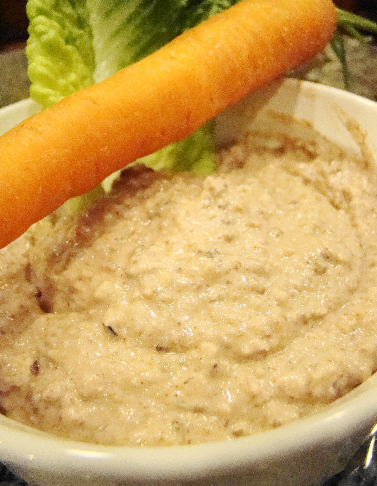

# Hummus con zanahoria

Comida ligera y sencilla · 1 ración · 2 min

*Foto: [Vegan Feast Catering](https://commons.wikimedia.org/wiki/File:Hummus_and_carrot_(3841125815).jpg) · [CC BY 2.0](https://creativecommons.org/licenses/by/2.0/).*

## Ingredientes

- 100 g de hummus
- 1 zanahoria grande
