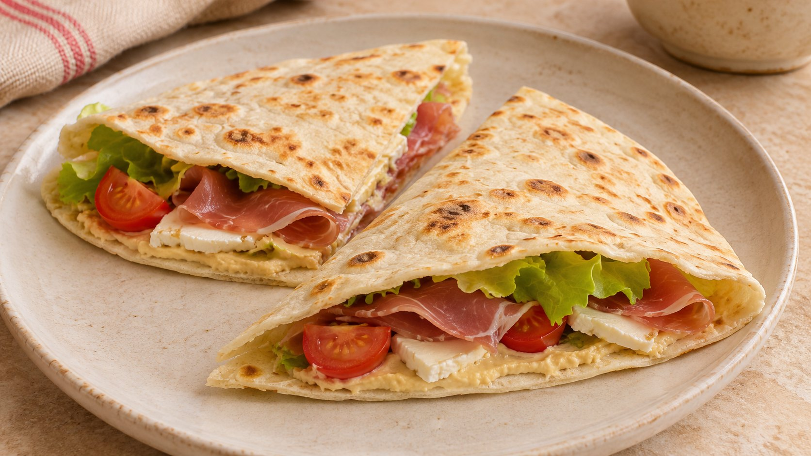

# La Piadina di Marisa

Con hummus, jamón cocido o pavo cocido, queso de cabra, cherry y brotes · 2 raciones · 10-15 min

Ilustración generada con IA.

## Ingredientes

- 2 piadinas medianas (22-25 cm)
- 80 g de hummus
- 160 g de tomates cherry
- 40 g de brotes de lechuga
- 40 g de jamón cocido o pavo cocido en lonchas finas
- 40 g de queso de cabra en lonchas

## Preparación

1. **Prepara el relleno · 4-5 min.** Lava y seca los cherry, córtalos en cuartos y déjalos escurrir; si sueltan mucho jugo, sécalos con papel. Lava los brotes si lo necesitan y sécalos muy bien. Separa las lonchas y trocea el queso. Divide los ingredientes en dos partes: harás una piadina cada vez.

2. **Templa la piadina · 30-60 s.** Calienta una sartén amplia y seca a fuego medio-bajo. Pon una piadina unos 20-30 segundos y dale la vuelta: debe quedar caliente, flexible y ligeramente tostada, sin endurecerse. Si el envase indica otra preparación, respétala y adapta este calentado.

3. **Rellena con hummus y queso y dobla · 1 min.** Aparta la sartén del fuego. Extiende 40 g de hummus en una capa fina sobre una mitad de la piadina, dejando 2 cm libres en el borde. Reparte 20 g de queso y dobla la mitad vacía sobre el relleno, sin aplastarlo.

4. **Dora con tapa y termina destapada · 50-90 s.** Devuelve la piadina doblada a la sartén seca, a fuego medio-bajo. Tapa y calienta la primera cara 30-60 segundos para ablandar el queso. Destapa, dale la vuelta con una espátula y dora la segunda cara 20-30 segundos, sin tapa. Vigila el punto: queso blando, exterior ligeramente dorado y masa todavía flexible; no hace falta que el queso se funda por completo. Retira a un plato.

5. **Añade el relleno fresco y sirve · 2-3 min para terminar ambas.** Abre la piadina con cuidado, ayudándote con la espátula, y añade 20 g de jamón cocido o pavo cocido en pliegues sueltos, 80 g de cherry escurridos y 20 g de brotes. Reparte sin amontonar y cierra sin aplastar. Sirve enseguida, entera o cortada con cuchillo de sierra. Repite con la segunda; para servir juntas, termina las dos bases calientes seguidas y añade los ingredientes frescos al final.

## Claves

Tomates escurridos y brotes bien secos. Hummus en capa fina. La tapa ayuda a ablandar el queso; termina destapada para recuperar el tostado, sin resecar la base. Ajusta el tiempo al fuego y al punto del queso. El golpe final de sartén se hace solo con hummus y queso dentro; las lonchas, el cherry y las hojas entran después, fuera del fuego. No añadas sal de entrada: prueba antes el fiambre, el queso y el hummus.

## Opciones

**Fiambre y montaje:** Usa jamón cocido o pavo cocido, en lonchas finas. No hace falta aceite en la sartén antiadherente.

**Otros rellenos:** Las cantidades siguientes son por piadina y sustituyen al relleno principal. Duplica para dos. Conserva una base por persona; los 10-15 min corresponden solo a la versión principal.

**Pollo, calabacín y salsa de yogur:** Por piadina: 100 g de pollo, 100 g de calabacín, 10 g de rúcula o canónigos, 30 g de yogur natural y ½ cucharadita de aceite. Saltea el calabacín en medias lunas finas 6-8 min; reserva. Cocina el pollo en tiras hasta que esté completamente hecho (74 °C en el centro). Monta con el yogur y las hojas fuera del fuego.

**Hummus, berenjena asada y tomate:** Por piadina: 40 g de hummus, 100 g de berenjena ya asada, 50 g de tomate y una pizca de comino. Para asar la berenjena, córtala en láminas, pincela con ½ cucharadita de aceite por ración y hornea a 200 °C, 20-25 min, hasta tierna. Déjala templar; añade el tomate escurrido al final.

**Espinacas, champiñones y requesón:** Por piadina: 60 g de espinacas, 100 g de champiñones, 50 g de requesón, ½ cucharadita de aceite y pimienta. Saltea los champiñones laminados 5-7 min; añade las espinacas 1-2 min y deja evaporar el agua. Fuera del fuego, incorpora el requesón bien escurrido y rellena.

**Sardinas, pimientos asados y rúcula:** Por piadina: 60 g de sardinas en conserva escurridas, 60 g de pimientos asados escurridos y 10 g de rúcula. Si vienen en aceite, usa hasta ½ cucharadita para dar jugosidad. Templa solo la piadina; añade el relleno fuera del fuego y evita recalentarlo.

## Fuente

Combinación propuesta en casa, con alternativas de relleno desarrolladas para Casa Marisa.
