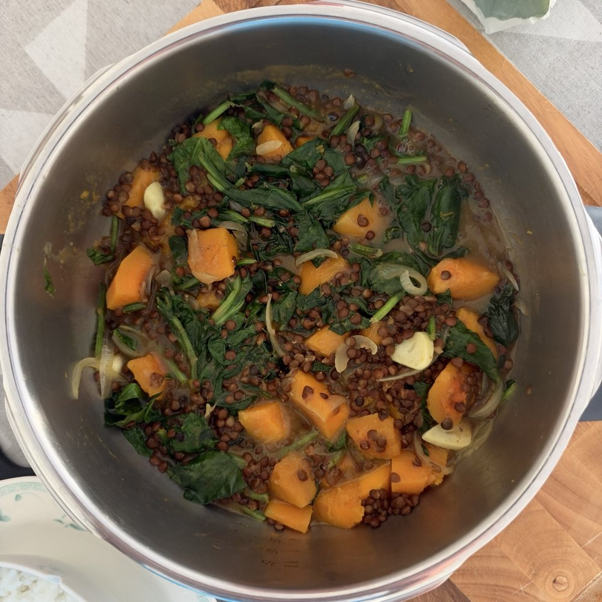

# Lentejas cremosas con calabaza y espinacas

Guiso especiado y cremoso

*Foto: [Yummy O Yummy](https://commons.wikimedia.org/wiki/File:Dal_Palak_Spinach_and_lentil_curry_(15914333462).jpg) · [CC BY 2.0](https://creativecommons.org/licenses/by/2.0/).*

[Descargar receta en PDF · A4](lentejas-calabaza-espinacas-400g.pdf)

## Ingredientes

- 400 g lentejas cocidas en conserva (peso escurrido)
- 350 g calabaza pelada
- 100–125 g espinacas frescas
- 1 unidad cebolla (mediana)
- 2 dientes ajo
- 10 g jengibre fresco
- 150 ml leche de coco
- 200 ml caldo de verduras (más un poco extra si hace falta)
- 1 cucharadita curry en polvo
- 0.5 cucharadita comino molido
- 2 cucharadas aceite de oliva virgen extra
- sal y pimienta negra (al gusto)
- zumo de limón (unas gotas al final)

## Preparación

1. **Preparar las verduras · 3-4 min.** Corta la calabaza en dados de unos 2 cm, la cebolla en juliana fina y pica el ajo y el jengibre. Lava y escurre las espinacas.
2. **Dorar la calabaza · 4-5 min.** Calienta una cucharada de aceite en una olla de acero a fuego medio-alto. Dora ligeramente la calabaza, removiendo de vez en cuando, y retírala. No tiene que cocinarse por dentro.
3. **Preparar el sofrito · 7-8 min.** Baja a fuego medio y añade el aceite restante. Sofríe la cebolla con una pizca de sal hasta que esté tierna. Si el fondo se pega, desglasa con una cucharada de agua. Añade ajo y jengibre el último minuto.
4. **Tostar las especias · 30 segundos.** Incorpora curry y comino y remueve sin parar unos 30 segundos, evitando que se quemen.
5. **Cocinar la calabaza · 10-15 min.** Devuelve la calabaza a la olla, añade el caldo reservado para esta fase, tapa y cuece a hervor suave hasta que esté casi tierna pero conserve su forma.
6. **Añadir las lentejas y el coco · 5 min.** Incorpora simultáneamente las lentejas escurridas y enjuagadas y la leche de coco. Cocina destapado a fuego bajo y remueve con suavidad. Añade caldo reservado si hace falta.
7. **Añadir las espinacas · 2-3 min.** Incorpora las espinacas al final, hasta que se ablanden. Corrige de sal y pimienta.
8. **Terminar y reposar · 3-5 min.** Apaga el fuego, añade unas gotas de limón y deja reposar con la olla tapada.

## Claves

Para espesar, aplasta algunos dados de calabaza. Remueve con cuidado para no romper las lentejas. Ajusta el caldo poco a poco.

