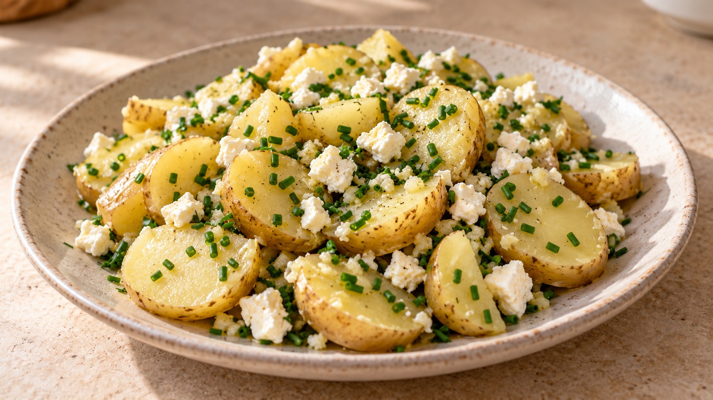

# Patatas al vapor sabrosas

Con feta y lima · estuche de vapor al microondas · 2 raciones · 15 min

Ilustración generada con IA.

## Ingredientes

- 400 g de patatas lavadas o patacas novas de temporada
- 1 diente de ajo
- 1 lima
- 1 cucharadita de aceite de oliva (5 ml)
- 1 cucharada de agua (15 ml)
- 50 g de queso feta
- 1 hoja pequeña de laurel
- 1 cucharada de cebollino
- Sal y pimienta

## Preparación

1. **Prepara las patatas y el ajo · 4 min.** Si no las compraste ya lavadas, lava y cepilla bien las patatas; también las novas si traen tierra. Conserva la piel si es fina y está en buen estado; en caso contrario, pélalas. Si son pequeñas, córtalas a la mitad; si son medianas, en rodajas de unos 5 mm y, si son aún más grandes, en medias lunas del mismo grosor. Pica fino el diente de ajo. Lava y pica el cebollino. Corta la lima por la mitad.

2. **Sazona en el estuche · 1 min.** Pon las patatas en el estuche de vapor apto para microondas. Añade el ajo picado, la hoja de laurel, el zumo de media lima y la cucharada de agua. Pon una pizca de pimienta y muy poca sal, porque el feta ya aporta sal. Mezcla y reparte sin compactar; cierra el estuche siguiendo sus instrucciones.

3. **Cocina y comprueba el punto · 8 min a 800 W + 1 min de reposo.** Cocina 8 minutos a 800 W. Deja reposar 1 minuto con el estuche cerrado y ábrelo con cuidado, apartando el vapor de la cara. Pincha una de las piezas más gruesas: el cuchillo debe entrar sin resistencia. Si sigue firme, mezcla con suavidad, vuelve a cerrar y cocina en tandas de 1 minuto hasta que esté tierna.

4. **Termina y aliña · 1 min.** Retira la hoja de laurel y pasa las patatas a una fuente con el jugo que quede en el estuche. Añade el feta desmenuzado y el cebollino picado, y aliña con la cucharadita de aceite. Mezcla con cuidado y prueba. Exprime poco a poco la otra mitad de la lima solo si quieres más frescor y ajusta la pimienta o la sal después de probar el queso.

## Claves

El corte uniforme permite que las patatas se hagan a la vez. Empieza con media lima y ajusta al final; no hace falta gastar todo el zumo. La cucharada de agua mantiene un poco de humedad al reducir el cítrico. El tiempo es orientativo: comprueba el centro y prolonga en tandas cortas. Respeta las indicaciones y la capacidad de tu estuche.

## Opciones

**Otras hierbas para el vapor:** En lugar del laurel, usa una ramita pequeña de tomillo o una pizca si es seco. También puedes elegir un trocito de ramita de romero; pon poco porque domina fácilmente. Añádelos antes de cocinar y retira los tallos al terminar.

**Otras hierbas para el final:** Sustituye el cebollino por una cucharada de perejil picado, 1–2 cucharaditas de eneldo picado, 2–3 hojas de hierbabuena picadas o una pizca de orégano seco (¼ de cucharadita). Elige una sola alternativa y añádela al servir. También puedes prescindir de la hierba final si te basta con el aroma del laurel.

**Para cenar:** Acompaña las patatas con una lata de sardinillas en aceite. Aprovecha una cucharadita del aceite de la conserva para el aliño final, en lugar de añadir aceite de oliva aparte. Con las sardinillas queda especialmente bien el eneldo en lugar del cebollino.

## Fuente

Adaptada de un folleto de recetas para estuche de vapor aportado por el usuario.
