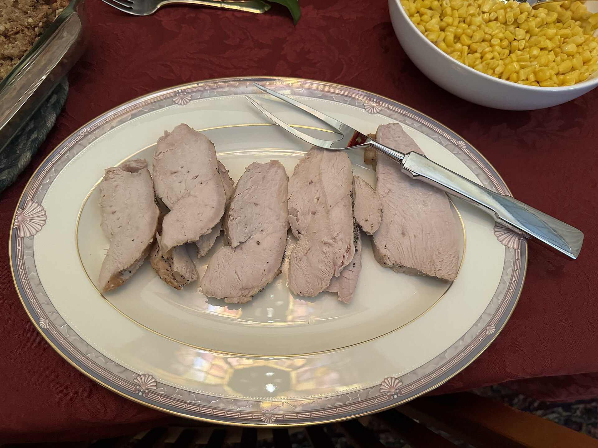

# Pechuga de pavo a la plancha

Rápida y jugosa · 2 raciones · 10-12 min

*Foto: [Sarah Stierch](https://commons.wikimedia.org/wiki/File:Cooked_turkey_breast_-_November_2023_-_Sarah_Stierch.jpg) · [CC BY 4.0](https://creativecommons.org/licenses/by/4.0/).*

## Ingredientes

- 300 g de filetes de pechuga de pavo
- 1 cucharada de aceite de oliva virgen extra (15 ml)
- sal y pimienta negra al gusto
- limón (opcional, para servir)

## Indicaciones

Seca los filetes con papel de cocina y salpimiéntalos. Calienta bien una sartén con el aceite y cocina el pavo 2-3 minutos por cada lado, según el grosor, hasta que esté hecho pero aún jugoso. Déjalo reposar 2 minutos antes de servir y añade limón si te apetece.

## Consejo

No lo cocines más de lo necesario: el pavo se seca con facilidad.
