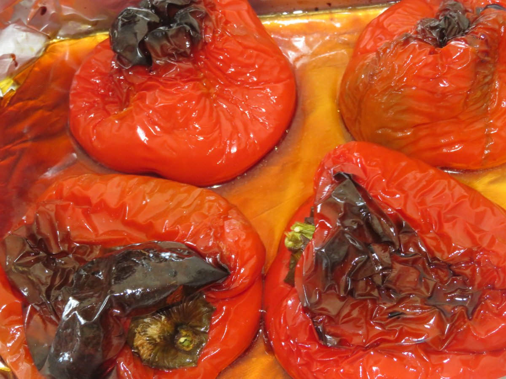

# Pimientos asados con cebolla

Cosori Dual Blaze · Veggies a 190 °C · 3-4 raciones de acompañamiento · 45-50 min

Foto: <a href="https://commons.wikimedia.org/wiki/File:Pimientos_rojos,_asados_al_horno_(Espa%C3%B1a).jpg">Juan Emilio Prades Bel</a> · <a href="https://creativecommons.org/licenses/by-sa/4.0">CC BY-SA 4.0</a>. Fotografía representativa de pimientos asados; la preparación de esta ficha incluye cebolla y se cocina en freidora de aire. Reducida para web.

[Descargar PDF A4](pimientos-asados-cebolla-cosori.pdf)

## Ingredientes

- 2 pimientos morrones grandes
- 1 cebolla (mitades o cuartos, según tamaño)
- Aceite de oliva virgen extra (spray y aliño)
- Sal al gusto
- Ajo crudo en láminas finas (opcional)
- ½ cdta. de orégano o ¼ cdta. de comino (opcionales)

## Preparación

1. **Prepara las verduras · 3-5 min.** Lava y seca bien los pimientos; déjalos enteros, con su pedúnculo. Pela la cebolla y córtala por la mitad si es pequeña o en cuartos si es grande. Conserva un poco de la base para mantener unidas las capas.

2. **Prepara la cesta · 1-2 min.** Retira la rejilla extraíble y coloca en el fondo una bandejita de papel de horno adecuada para la freidora y resistente, como mínimo, a 190 °C. No debe sobresalir ni quedar encajada bloqueando la circulación de aire. Pon siempre las verduras encima antes de encender: nunca hagas funcionar la freidora con el papel vacío.

3. **Coloca y aceita · 1-2 min.** Pulveriza muy ligeramente la bandejita: sobre el papel antiadherente apenas hace falta aceite. Pulveriza también la cara superior de los pimientos. Colócalos tumbados, uno junto al otro, con la cebolla en los huecos, sin apilar ni apretar las piezas.

4. **Asa y da la vuelta · 15 + 10 min.** Sin precalentar, selecciona Veggies a 190 °C durante 15 minutos. Da la vuelta a los pimientos, recoloca la cebolla y pulveriza ligeramente la otra cara si lo necesita. Cocina otros 10 minutos con el mismo programa y temperatura.

5. **Comprueba el punto · Al terminar; 3-5 min extra si hace falta.** Los pimientos deben estar blandos, algo hundidos y con la piel arrugada y tostada por zonas. La cebolla debe atravesarse fácilmente con un cuchillo. Retira cada pieza cuando esté lista; si hace falta, prolonga el asado en tandas de 3-5 minutos. Los tiempos son orientativos: ajústalos al tamaño de las verduras y a la carga.

6. **Reposa, pela y corta · 10-15 min de reposo; después pelar.** Pasa los pimientos a un recipiente y tápalos para facilitar el pelado. Reserva los jugos. Cuando puedas manipularlos, retira piel, pedúnculos y semillas, sin enjuagarlos para no perder sabor. Corta la carne en tiras y la cebolla en trozos o separa sus capas.

7. **Mezcla y aliña · 2-3 min.** Pon los pimientos y la cebolla en un recipiente limpio. Añade los jugos colados para retirar semillas o restos de piel, sal al gusto y un poco de aceite. Si quieres, incorpora el ajo laminado y una de las especias opcionales. Mezcla suavemente. Sirven para picotear, como guarnición o como base de ensaladas.

## Conservación

Guarda en un recipiente limpio, poco profundo y cerrado, en la nevera a 4 °C o menos. Consume en 3-4 días desde el asado. Refrigera antes de que transcurran dos horas desde la cocción, sin esperar a que se enfríe completamente sobre la encimera. Para más tiempo, congela porciones.

El aceite es un aliño: no convierte la preparación en una conserva. Si añades ajo crudo al aceite, mantén siempre refrigerado y no superes los 4 días por el [riesgo de botulismo](https://nchfp.uga.edu/how/freeze/vegetable/freezing-garlic-in-oil/). También puedes añadir el ajo solo a la porción que vayas a servir.
