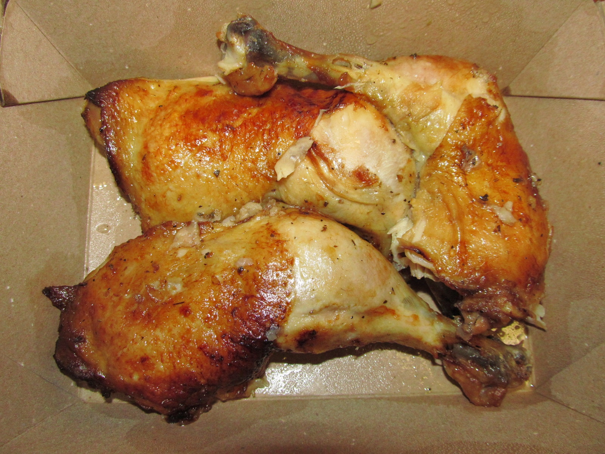

# Pollo Satisfryer

Pollo asado con verduras · Cosori Dual Blaze · 2 raciones · 55-65 min

## Ingredientes

- 2 cuartos traseros de pollo, con hueso y piel
- ½ calabacín mediano (150 g)
- ½ berenjena pequeña (150 g)
- 1 cebolla pequeña
- ½ pimiento verde
- 1 tomate mediano
- 10 ml AOVE (2 cdtas.; incluido el papel)
- 30 ml vino blanco seco (2 cdas.)
- ½ cdta. tomillo seco
- ½ cdta. romero seco desmenuzado
- Sal moderada y pimienta negra

## Preparación

1. **Corta las verduras · 8-10 min.** Calabacín con piel: rodajas de 1,5-2 cm; berenjena con piel: medias lunas del mismo grosor; cebolla: rodajas de 1 cm; pimiento: tiras de 2-3 cm; tomate: 6 gajos.

2. **Prepara la cesta · 2 min.** Retira la rejilla. Coloca una bandejita de papel de horno apta para 180 °C, sin bordes sobresalientes. Pincela el fondo con un poco del aceite medido. Nunca enciendas con el papel vacío; debe estar sujeto por los alimentos.

3. **Monta las capas y aliña · 3 min.** Orden desde abajo: papel aceitado; cebolla; calabacín y berenjena intercalados en una misma capa; pimiento y tomate repartidos encima. No mezcles las capas. Del aceite total, usa 5 ml entre papel y verduras, pincelando especialmente la berenjena. Añade vino, sal moderada, pimienta y la mitad de las hierbas.

4. **Coloca el pollo y empieza el asado · 20 min.** Seca el pollo y colócalo encima de las verduras, sin superponer piezas, con la piel hacia abajo. Pincela con los otros 5 ml de aceite y condimenta con parte de las hierbas restantes. Sin precalentar, selecciona Air Fry a 180 °C durante 20 min.

5. **Gira y termina de asar · 20 min orientativos.** Gira solo el pollo: piel hacia arriba. Añade las hierbas reservadas, sin volver a salar. Mueve suavemente solo las verduras accesibles, manteniéndolas debajo. Cocina otros 20 min a 180 °C. Ajusta al tamaño y la carga: 40 min en total es una referencia.

6. **Comprueba el punto · 0-10 min extra si hace falta.** Mide 74 °C en la parte más gruesa de cada pieza sin tocar el hueso. Si falta, prolonga en tandas de 3-5 min. La berenjena debe quedar bien tierna. Retira el pollo cuando esté hecho y termina las verduras aparte si lo necesitan.

7. **Reposa y sirve · 5 min.** Deja reposar el pollo 5 min fuera de la freidora. Sirve con las verduras y la cantidad de jugos que prefieras; puedes apartar la piel al comer.

## Alternativa con tubérculos

Con patata o boniato: sustituye calabacín y berenjena por 250-300 g de tubérculos en rodajas de 5 mm. Capas desde abajo: papel aceitado, cebolla, patata o boniato, y pimiento y tomate encima. Usa los mismos 5 ml de aceite para papel y base; añade vino y aliño. Cocina esta base completa 10 min a 180 °C sin pollo. Después coloca el pollo encima y empieza sus 20 + 20 min; no repitas el aceite ni el vino de la base. Comprueba que los tubérculos estén tiernos. Calcula unos 10 min más de tiempo total.

## Claves

Para una versión más ligera: retira la piel antes de cocinar para reducir la grasa que pasa a las verduras. Si lo asas con piel, apártala al comer y evita servir toda la grasa del fondo.

No amontonar las verduras; reducir cantidades si no caben.

Fuente: [reel de Fussimonsi](https://www.instagram.com/reel/C-BHEvYoYKl/), adaptado con cantidades medidas, verduras como base y vino seco.

Fotografía representativa: [Willis Lam](https://commons.wikimedia.org/wiki/File:Roast_Chicken_Legs_and_Thighs_(31196736704).jpg) · [CC BY-SA 2.0](https://creativecommons.org/licenses/by-sa/2.0/). Presentación recortada a 16:9; original conservado.
