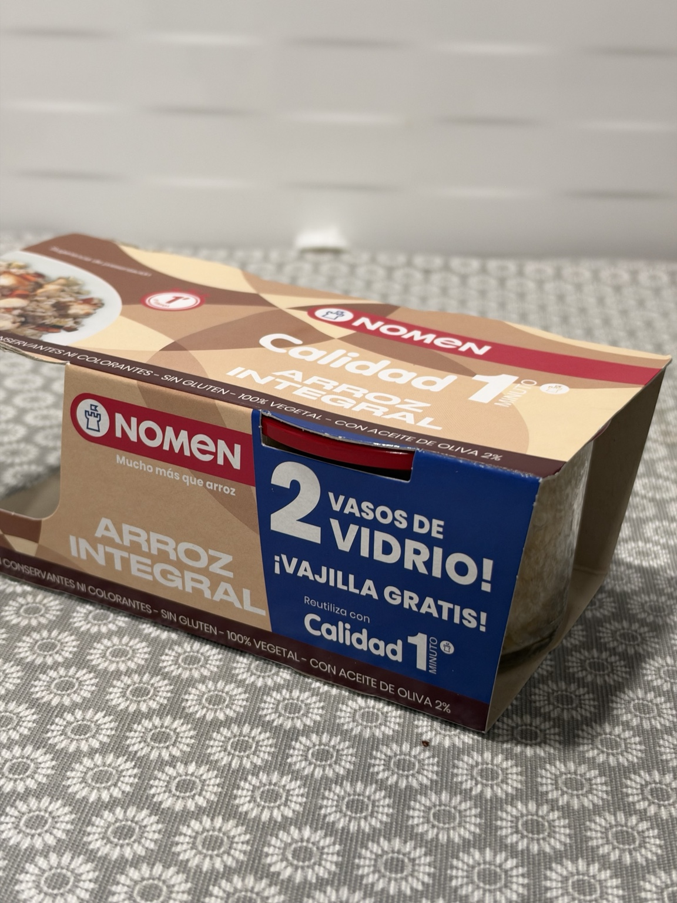
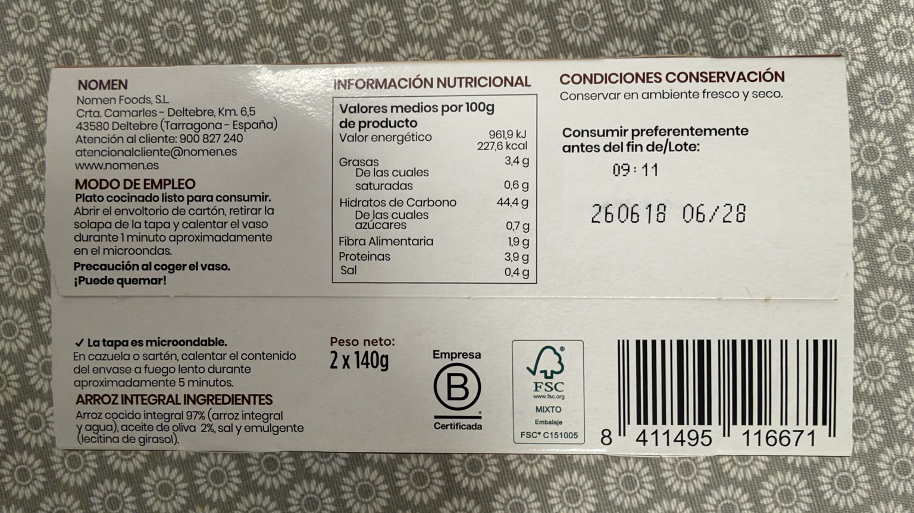

# Arroz integral Calidad 1 minuto

Nomen · Pack de 2 vasos de vidrio de 140 g (280 g en total).

## Por qué lo uso

Sobre todo en burritos, como sustituto de la quinoa, que a mi madre no le gusta.

## En mi cocina

Arroz ya cocinado para incorporar al relleno. La cantidad que uso está pendiente de concretar; no se equipara su peso al de quinoa en seco.

Según el envase, se calienta el vaso en el microondas aproximadamente 1 minuto, tras abrir el cartón y retirar la solapa de la tapa. La tapa es microondable. También puede calentarse el contenido en una sartén o cazuela a fuego lento unos 5 minutos. El vaso puede quemar al cogerlo.

## Composición

Arroz cocido integral 97 % (arroz integral y agua), aceite de oliva 2 %, sal y emulgente (lecitina de girasol).

## Por 100 g, según el envase

961,9 kJ / 227,6 kcal; grasas 3,4 g, saturadas 0,6 g, hidratos 44,4 g, azúcares 0,7 g, fibra 1,9 g, proteínas 3,9 g y sal 0,4 g.

## Compra y Yuka

El ticket de Carrefour Los Rosales del 30/09/2026 recoge «ARROZ INTEGRAL NOME», 2,35 €. El usuario confirma el pack de 2 × 140 g: **8,39 €/kg**, calculado sobre 280 g netos.

Yuka: **78/100 · Excelente**, según la captura aportada el 16/10/2026. Los comentarios positivos y el dato redondeado de energía de Yuka se conservan separados de la etiqueta.

## Fotografías

[Captura de Yuka](../images/productos/arroz-integral-nomen-yuka.jpeg)
