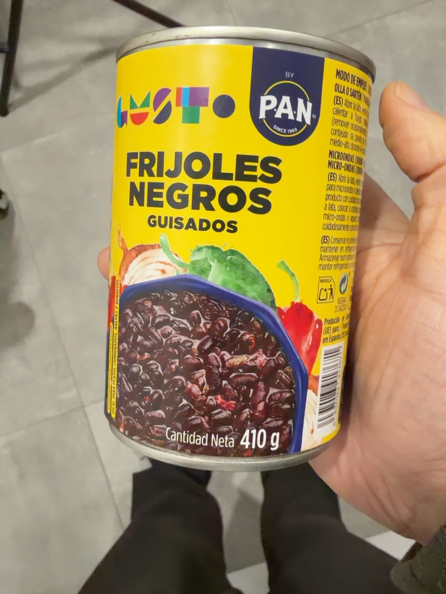
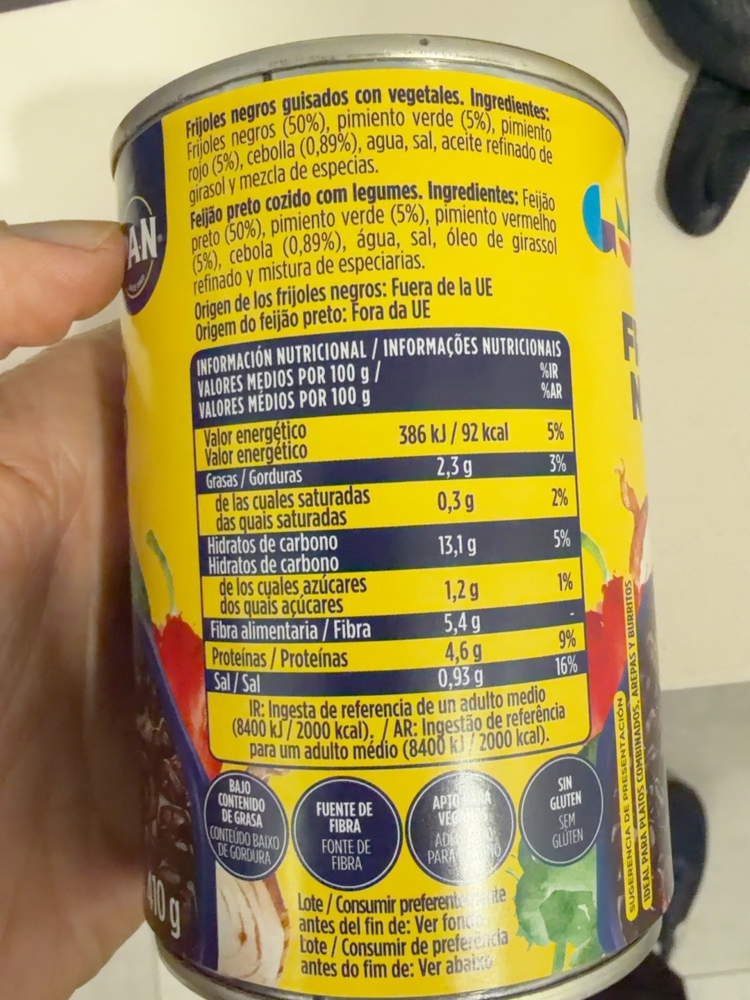

# Frijoles negros guisados

GUSTO by P.A.N. · Lata de 410 g, incluido el contenido de salsa.

## Por qué lo uso

Ya llevan cebolla y pimientos, así que me ahorro preparar otro sofrito. Los utilizo con su salsa para el relleno de los burritos.

## En mi cocina

Vierto la lata completa, sin escurrir ni enjuagar, y dejo espesar la salsa en la sartén antes de mezclar con la quinoa y el edamame.

## Composición

Frijoles negros (50 %), pimiento verde (5 %), pimiento rojo (5 %), cebolla (0,89 %), agua, sal, aceite refinado de girasol y mezcla de especias.

## Valores por 100 g

386 kJ / 92 kcal; grasas: 2,3 g; saturadas: 0,3 g; hidratos: 13,1 g; azúcares: 1,2 g; fibra: 5,4 g; proteínas: 4,6 g; sal: 0,93 g.

Fuente: fotografías de la etiqueta aportadas por el usuario el 14/10/2026. Las imágenes se conservan completas.

## Compra y valoración

Precio de referencia, fecha del precio, tiendas, enlaces de compra y valoración de Yuka: pendientes de registrar. No se ha realizado una valoración nutricional independiente ni se ha estimado una nota de Yuka.

## Recetas

- [Burritos de frijoles negros, quinoa, edamame y champiñones](../burritos-frijoles-quinoa-edamame-champinones.html)

## Fotografías propias

