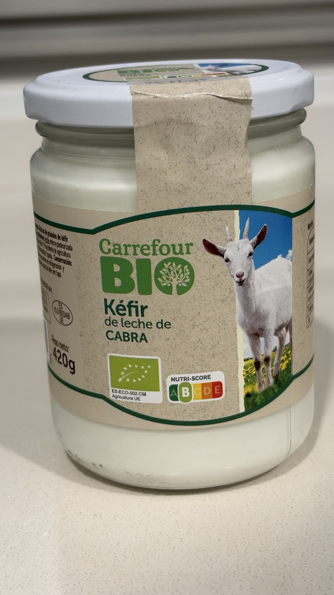
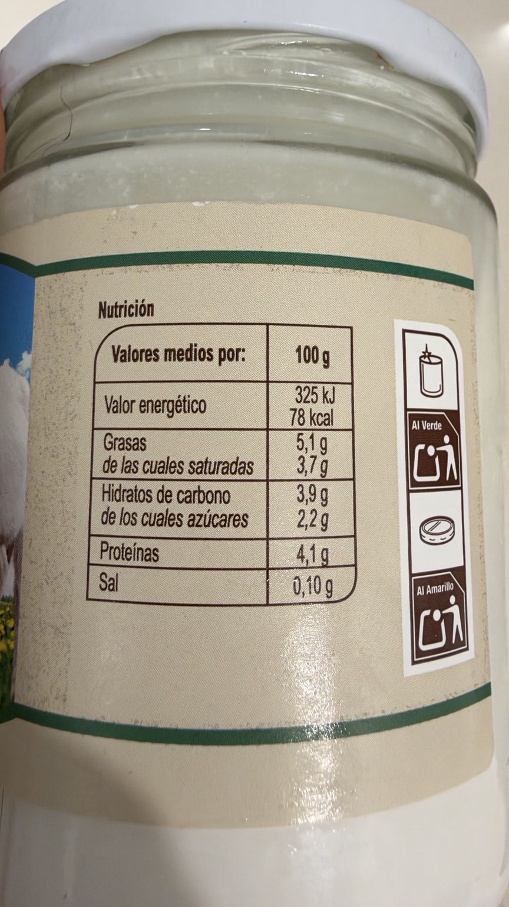
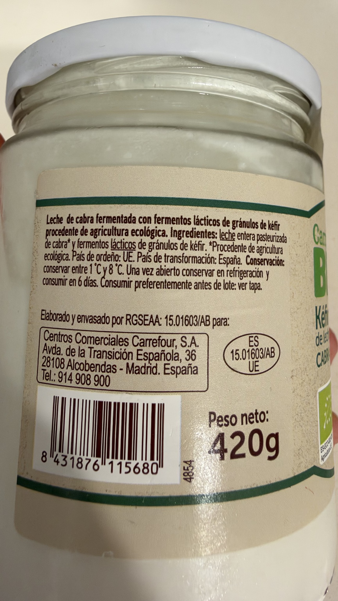

# Kéfir de leche de cabra

Carrefour Bio · Tarro de cristal de 420 g · Ecológico · Nutri-Score B según el envase.

## Por qué lo uso

Es uno de mis productos favoritos para tomar como tentempié o postre.

## Cómo lo tomo

Solo o mezclado con frutos secos o fruta fresca. A veces añado **2 cucharaditas de lino molido** para aportar fibra.

## Composición

Leche entera pasteurizada de cabra procedente de agricultura ecológica y fermentos lácticos de gránulos de kéfir. Alérgeno: leche.

País de ordeño: UE. País de transformación: España.

## Conservación

Conservar entre 1 °C y 8 °C. Una vez abierto, conservar en refrigeración y consumir en 6 días, según la etiqueta.

Elaborado y envasado por RGSEAA 15.01603/AB para Centros Comerciales Carrefour, S.A. Código de barras: 8431876115680.

## Valores por 100 g

325 kJ / 78 kcal; grasas: 5,1 g; saturadas: 3,7 g; hidratos de carbono: 3,9 g; azúcares: 2,2 g; proteínas: 4,1 g; sal: 0,10 g. Fibra no declarada en la tabla fotografiada.

## Compra y valoración

Precio de referencia: **2,99 € por tarro de 420 g (7,12 €/kg)**, Carrefour Los Rosales, 14/10/2026. El ticket incluye dos unidades por 5,98 €. El cheque ahorro general no se reparte entre productos.

Referencia anterior: 2,55 € el 12/09/2026, en el mismo establecimiento. Los tickets lo describen como «KEFIR CARREFOUR BIO»; el usuario identifica la referencia como este producto.

### Valoración de Yuka

**88/100 · Excelente.** Captura aportada el 15/10/2026; fecha de consulta no especificada.

Según Yuka: sin aditivos («Sin sustancia peligrosa»), ecológico («Sin pesticida de síntesis»), proteínas 3,4 g («Algunas proteínas»), energía 79 kcal («Bajo en calorías»), azúcar 3,9 g («Bajo en azúcar»), sal 0,09 g («Bajo en sal») y grasas saturadas 3 g («Impacto bajo»), por 100 g. No aparecen aspectos negativos en la captura.

Estos comentarios se atribuyen a Yuka. Sus valores difieren de la etiqueta fotografiada: esta declara proteínas 4,1 g, energía 78 kcal, azúcares 2,2 g, sal 0,10 g y saturadas 3,7 g por 100 g. Se mantienen los datos del envase en la tabla nutricional, sin presuponer la causa de las diferencias.

## Fotografías propias

