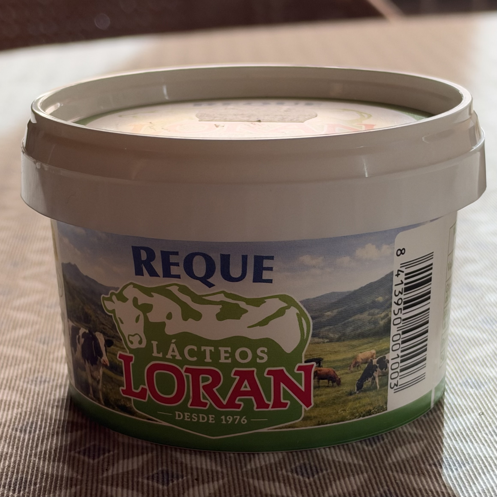
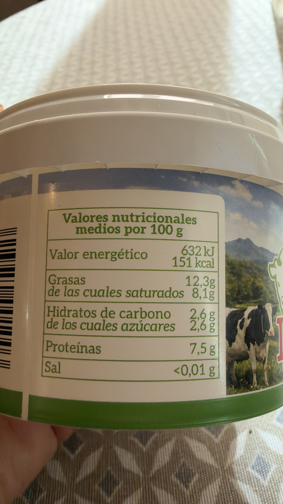
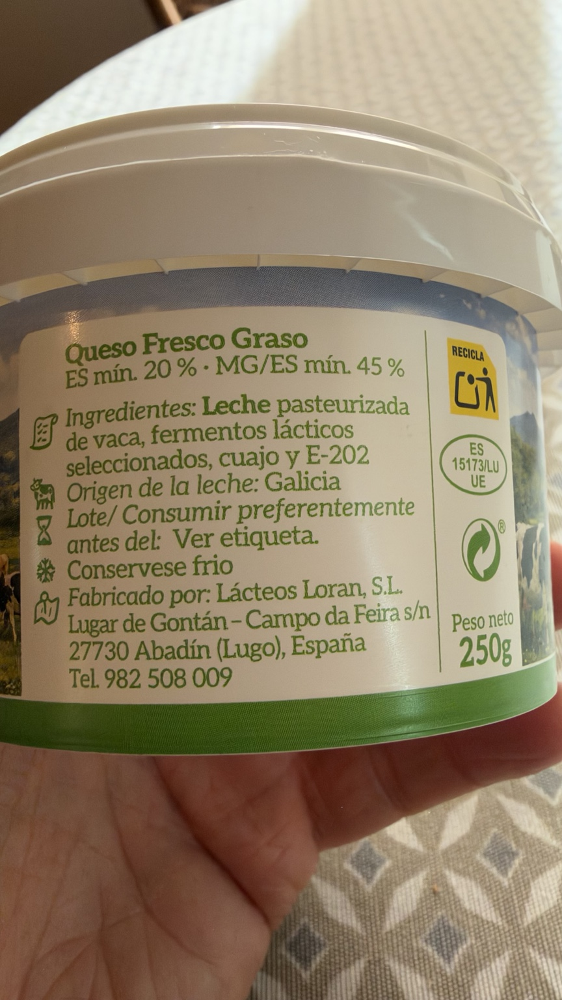

# Requesón Reque

Lácteos Loran · Tarrina de 250 g. Queso fresco graso de leche de vaca de Galicia.

## Por qué lo uso

Me gusta porque está rico y es gallego, un producto de proximidad. Lo uso para rellenar las [barquitas de endivia](../barquitas-endivia-requeson.html), con distintos aderezos.

## Composición y conservación

Leche pasteurizada de vaca, fermentos lácticos seleccionados, cuajo y E-202. Alérgeno: leche. Origen de la leche: Galicia. Consérvese frío.

Fabricado por Lácteos Loran, S.L., Abadín (Lugo). Extracto seco mínimo: 20 %; materia grasa sobre extracto seco mínima: 45 %.

## Valores por 100 g

632 kJ / 151 kcal; grasas: 12,3 g; saturadas: 8,1 g; hidratos de carbono: 2,6 g; azúcares: 2,6 g; proteínas: 7,5 g; sal: <0,01 g. La etiqueta no declara fibra.

## Precio y valoración

Precio de la tarrina fotografiada de 250 g: pendiente. Tienda para este formato: pendiente de confirmar. Valoración de Yuka: 48/100 · Mediocre. Capturas aportadas el 15/10/2026; fecha de consulta no especificada.

Referencia pendiente de comprobar: el ticket de Carrefour Los Rosales del 30/09/2026 indica «REQUESON LORAN 125G» a 1,30 €. El usuario sospecha un error en la descripción del peso: el envase fotografiado es de 250 g. No se calcula €/kg hasta confirmar el formato.

### Detalle de Yuka

Según Yuka, los aspectos positivos son proteínas 7,5 g («Algunas proteínas»), energía 151 kcal («Bajo en calorías»), azúcar 2,6 g («Bajo en azúcar») y sal 0 g («Sin sal»), por 100 g. La etiqueta declara sal <0,01 g; se conserva ese valor en los datos nutricionales.

Como aspectos negativos señala las grasas saturadas 8,1 g por 100 g («Alto en grasa») y un aditivo a evitar: E-202, sorbato de potasio, conservante que la app clasifica como «De riesgo». Estos comentarios se atribuyen a Yuka; no constituyen una evaluación propia de seguridad.

## Fotografías propias

